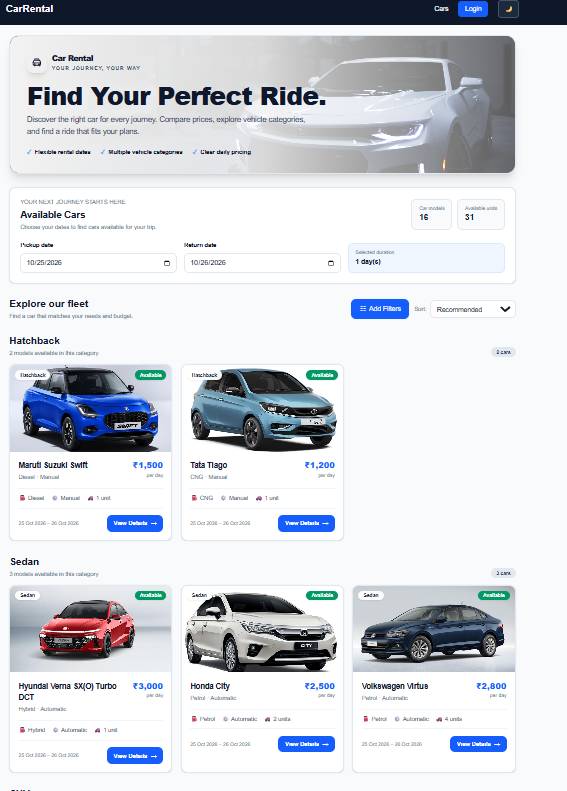
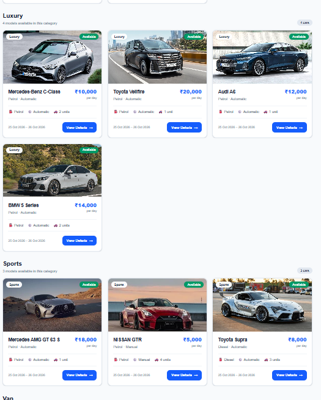
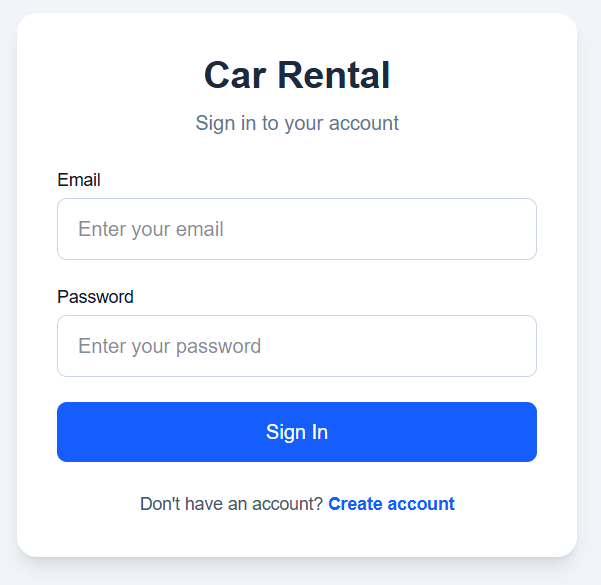
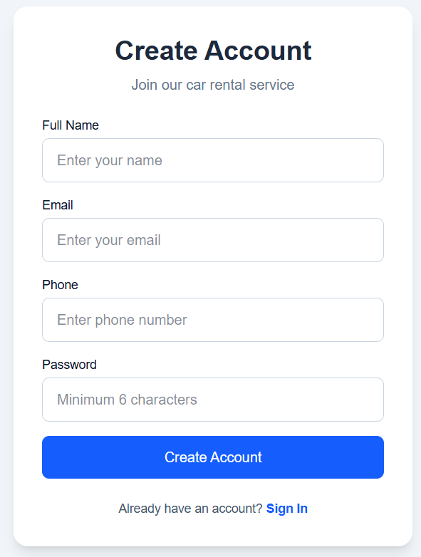
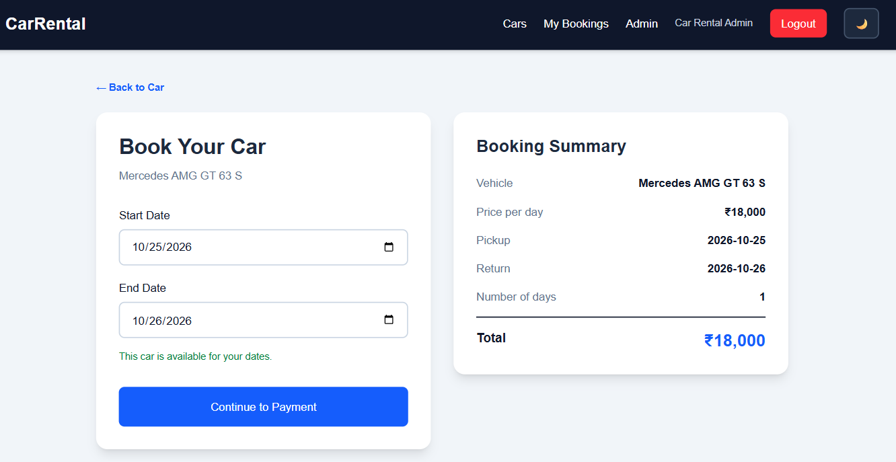
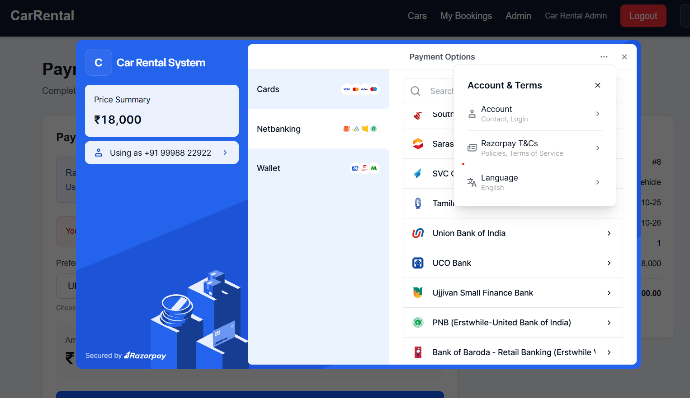
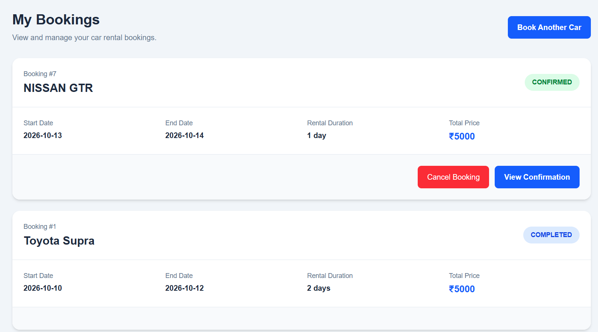
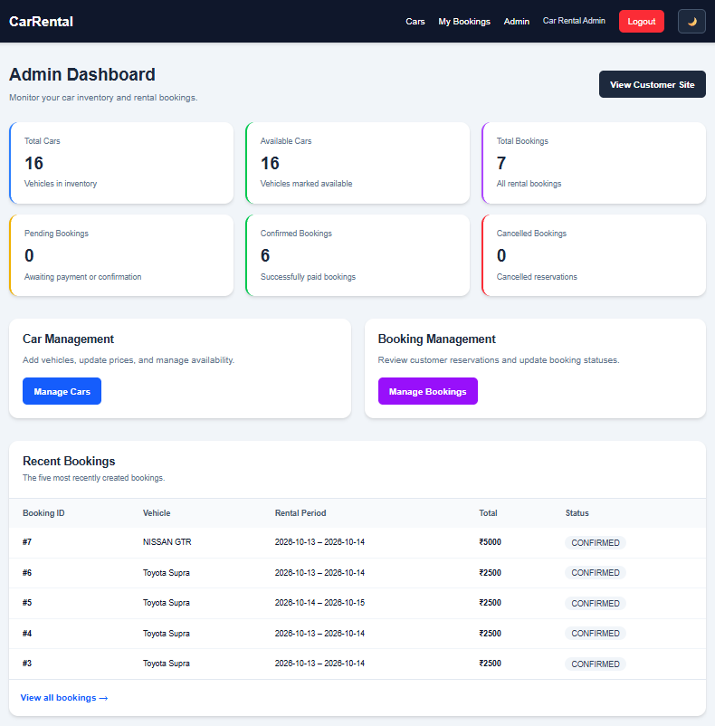
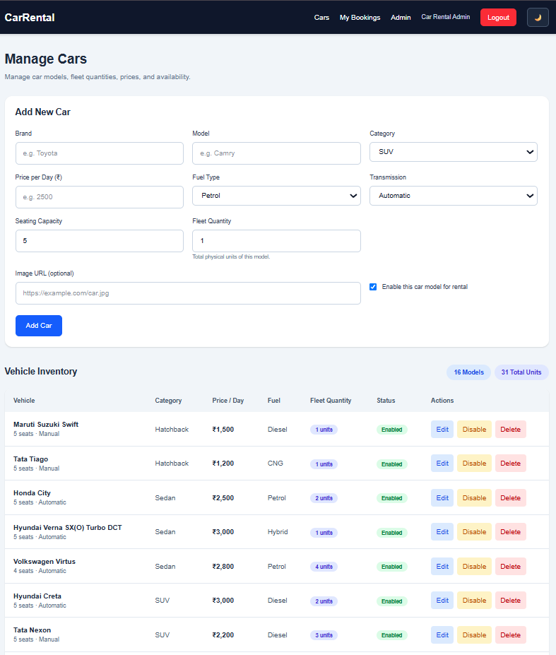
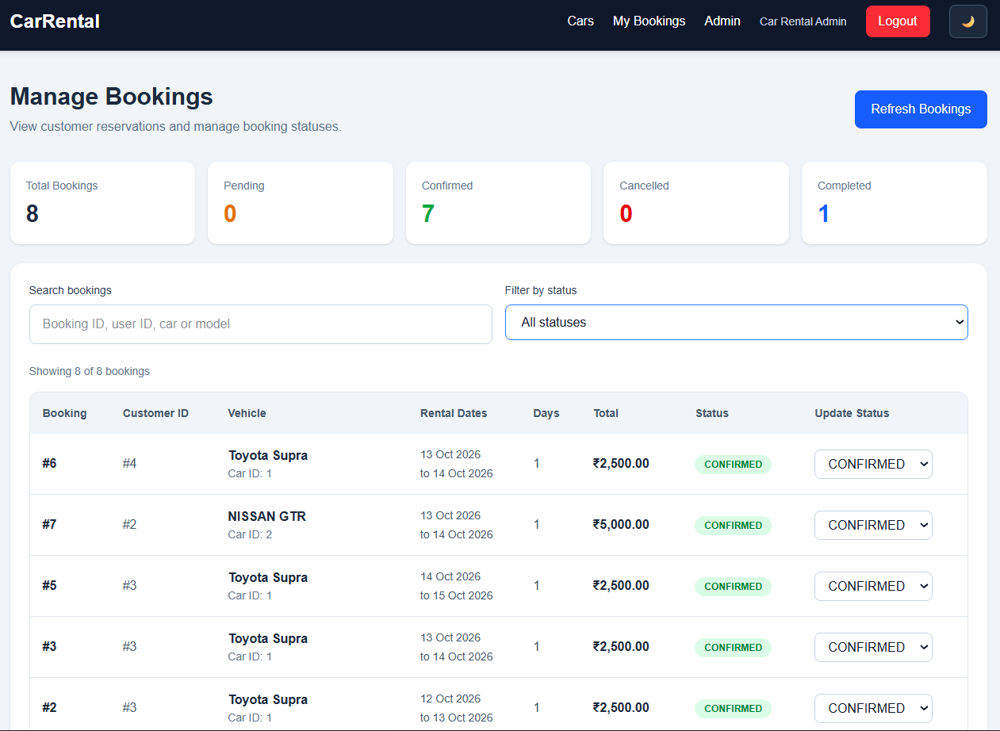

# 🚗 Car Rental System

A full-stack web application that enables users to browse available vehicles, compare rental prices, reserve cars for specific durations, make payments, and manage their bookings. Administrators can manage vehicle inventory and monitor reservations through a dedicated dashboard.

## 📌 Project Overview

A car rental system allows users to search for and book vehicles for specific durations. Users can browse available cars, compare prices, and make reservations. The platform also handles user authentication, payment processing, and booking confirmations. Administrators can manage vehicle inventory, monitor bookings.

This project implements the core car rental workflow through a React frontend, Spring Boot backend, PostgreSQL database, JWT authentication, and Razorpay payment integration.

## 🎯 Project Objectives

- Enable users to browse available rental vehicles and compare prices.
- Support reservations for selected pickup and return dates.
- Check vehicle availability and prevent overlapping active reservations.
- Provide secure user registration and authentication.
- Integrate payment processing and booking confirmation.
- Allow users to view and manage their bookings.
- Provide administrative tools for vehicle inventory and booking management.
- Establish a foundation for vehicle maintenance scheduling.

## ✨ Features

### 👤 User Features

- User registration and login.
- JWT-based authentication.
- Browse available rental cars.
- View vehicle details and rental prices.
- Filter cars by category, brand, model, price range, fuel type, and transmission.
- Check vehicle availability for selected dates.
- Book cars for a specified rental period.
- View personal booking history.
- Cancel bookings.
- Complete payments through Razorpay test-mode integration.
- View booking confirmation and payment status.

### 🛠️ Admin Features

- Administrator authentication and dashboard.
- Add, update, and manage vehicle inventory.
- Enable or disable vehicles.
- Manage customer bookings.
- Review booking statuses and booking statistics.
- Manage booking operations through a centralized interface.

### 🔐 Security

- Spring Security authentication and authorization.
- JWT-based stateless authentication.
- Password encoding.
- Protected API endpoints.
- Booking ownership checks.
- Environment-based configuration for database, JWT, and payment credentials.

## 🧰 Technology Stack

| Layer | Technologies |
|---|---|
| Frontend | React, TypeScript, Vite |
| Routing | React Router |
| State Management | Zustand |
| HTTP Communication | REST APIs, Axios |
| Backend | Java 21, Spring Boot |
| Security | Spring Security, JWT |
| Database | PostgreSQL |
| ORM | Spring Data JPA, Hibernate |
| Payments | Razorpay |
| API Testing | Postman |
| Build Tools | Maven, npm |
| Version Control | Git, GitHub |

## 🏗️ System Architecture

The application follows a client-server architecture.

```text
User / Administrator
        |
        v
React + TypeScript Frontend
        |
        | REST API requests
        v
Spring Boot Backend
        |
        +---- Spring Security + JWT
        |
        +---- Car Availability and Booking Logic
        |
        +---- Razorpay Payment Integration
        |
        v
PostgreSQL Database
```

**Frontend:** Provides the interface for browsing cars, booking vehicles, making payments, and managing reservations.

**Backend:** Processes API requests, validates access, manages business logic, and communicates with the database and payment integration.

**Database:** Stores application data, including users, vehicles, bookings, and payment records.

**Authentication:** JWT tokens authenticate users and protect authorized endpoints.

**Payment integration:** Razorpay supports the application's payment workflow.

## 🔄 Application Workflow

### User Workflow

1. Register a new account or log in.
2. Browse the available vehicles.
3. Filter cars and compare rental prices.
4. Select a vehicle and pickup and return dates.
5. Check availability and create a booking.
6. Proceed to the payment page.
7. Complete the payment through the configured payment integration.
8. View booking confirmation and payment status.
9. Review or cancel eligible bookings through My Bookings.

### Administrator Workflow

1. Log in with an authorized administrator account.
2. Open the admin dashboard.
3. Add or update vehicle information.
4. Manage vehicle availability and inventory.
5. Review customer reservations.
6. Monitor booking statuses and statistics.

## 📸 Application Screenshots

### 🚘 Available Cars





### 🔑 Authentication





### 📅 Booking and Payments







### 🛡️ Administration







## 📁 Project Structure

```text
car-rental-system/
├── car-rental-backend/
│   ├── src/
│   │   ├── main/
│   │   │   ├── java/com/carrental/
│   │   │   └── resources/
│   │   └── test/
│   ├── pom.xml
│   └── mvnw
├── car-rental-frontend/
│   ├── public/
│   ├── src/
│   │   ├── components/
│   │   ├── layouts/
│   │   ├── pages/
│   │   ├── services/
│   │   └── store/
│   └── package.json
├── screenshots/
│   ├── cars-page-1.png
│   ├── cars-page-2.png
│   ├── login-page.png
│   ├── createaccount-page.png
│   ├── CarBooking.png
│   ├── Payment.png
│   ├── mybookings-page.png
│   ├── AdminDashboard-page.png
│   ├── ManageCars-page.png
│   └── ManageBookings.png
├── postman/
├── .postman/
├── car.json
├── .gitignore
└── README.md
```

*The structure above summarizes the main project directories and files.*

## ⚙️ Prerequisites

Install the following software before running the application:

- Java Development Kit (JDK) 21
- PostgreSQL
- Node.js and npm
- Git
- A web browser
- Razorpay test-mode credentials for payment testing

## 🚀 Getting Started

### 1. Clone the Repository

```bash
git clone https://github.com/sridhar-varma27/car-rental-system.git
cd car-rental-system
```

### 2. Configure PostgreSQL

Create a database named `car_rental_db`:

```sql
CREATE DATABASE car_rental_db;
```

Ensure the PostgreSQL server is running and the database credentials are available.

### 3. Configure Backend Environment Variables

The backend reads database, JWT, and Razorpay settings from environment variables.

| Variable | Purpose |
|---|---|
| `DATABASE_URL` | PostgreSQL JDBC connection URL |
| `DATABASE_USERNAME` | PostgreSQL username |
| `DATABASE_PASSWORD` | PostgreSQL password |
| `JWT_SECRET` | Private secret used for signing JWT tokens |
| `RAZORPAY_KEY_ID` | Razorpay API Key ID |
| `RAZORPAY_KEY_SECRET` | Razorpay API secret |
| `PORT` | Backend port; defaults to `8082` |

The default local database URL is:

```text
jdbc:postgresql://localhost:5432/car_rental_db
```

Set all required variables in your local environment before starting the backend. Generate a strong, random JWT secret and use your own database credentials and Razorpay test credentials.

**Never commit real passwords, API secrets, or production credentials to GitHub.**

### 4. Start the Backend

Open a terminal in the project root.

On Windows PowerShell:

```powershell
cd car-rental-backend
.\mvnw.cmd spring-boot:run
```

The backend uses port `8082` by default.

Backend base URL:

```text
http://localhost:8082
```

API base URL:

```text
http://localhost:8082/api
```

### 5. Start the Frontend

Open a second terminal in the project root:

```powershell
cd car-rental-frontend
npm install
npm run dev
```

Open the local URL displayed by Vite, commonly:

```text
http://localhost:5173
```

Keep both the frontend and backend running while using the application. Ensure the frontend API base URL points to the running backend.

## 🔌 Main API Areas

The backend provides REST API functionality for the following areas:

- **Authentication:** Registration, login, and current-user details.
- **Cars:** Vehicle listings, availability, and inventory management.
- **Bookings:** Creating and managing rental reservations.
- **Payments:** Payment records and Razorpay payment processing.
- **Confirmations:** Booking confirmation details.
- **Administration:** Booking management and administrative operations.

Protected endpoints require appropriate authentication and authorization.

## 💳 Payment Integration

The application integrates Razorpay for payment processing.

- Configure credentials using environment variables.
- Use Razorpay test-mode credentials during development.
- Verify payment completion through the backend.
- Do not treat a frontend success message alone as proof of successful payment.

## 🧪 API Testing and Verification

Postman can be used to test authentication, car listings, booking operations, and payment-related endpoints.

Use the API base URL:

```text
http://localhost:8082/api
```

Authenticated requests must include a valid bearer token where required.

Important application workflows to verify include:

- User registration and login.
- Authenticated API access and administrative access control.
- Car listing and filtering.
- Availability checks for selected rental dates.
- Booking creation and prevention of overlapping active reservations.
- Payment status and booking confirmation.
- Booking cancellation and ownership checks.
- Vehicle inventory and booking management.

## 📋 Requirements Mapping

| Requirement | Corresponding Project Functionality |
|---|---|
| Search for vehicles | Car listing and filters |
| Compare prices | Rental price display and price filters |
| Book vehicles for specific durations | Pickup and return dates |
| Check availability | Date-based availability checks |
| User authentication | Registration, login, JWT |
| Payment processing | Razorpay integration |
| Booking confirmations | Confirmation page and status |
| Manage vehicle inventory | Admin Manage Cars |
| Monitor bookings | Admin Manage Bookings and dashboard |
| Handle maintenance schedules | Future enhancement unless implemented separately |

## 🔒 Security Notes

- Never commit `.env` files, database backups, private keys, or real API secrets.
- Use strong, private JWT signing secrets.
- Keep Razorpay credentials private.
- Use test credentials during development.
- Configure production CORS, HTTPS, database access, and environment variables before deployment.


## 👨‍💻 Author

**Sridhar Varma**

GitHub: [@sridhar-varma27](https://github.com/sridhar-varma27)

## 📄 License

No license has been specified yet. All rights are reserved unless a license is added to this repository.
